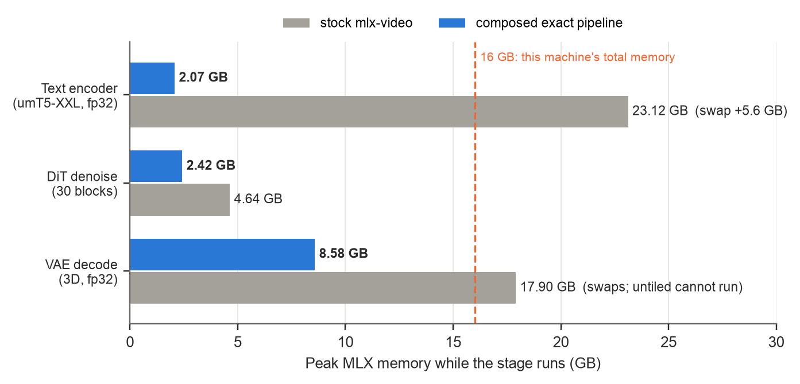
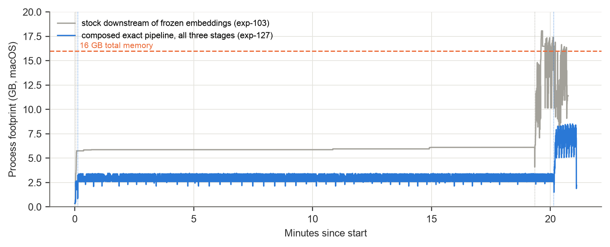
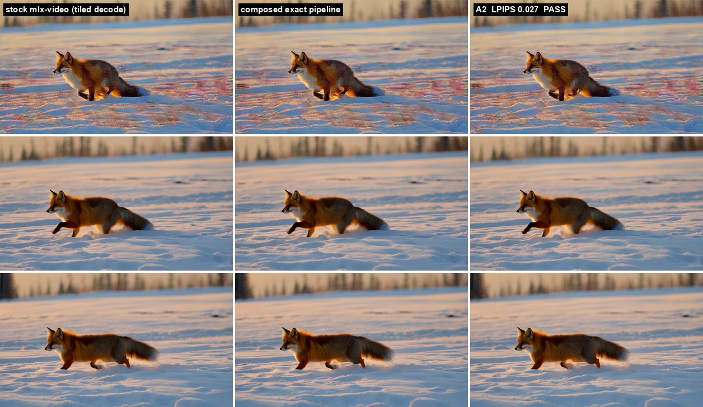
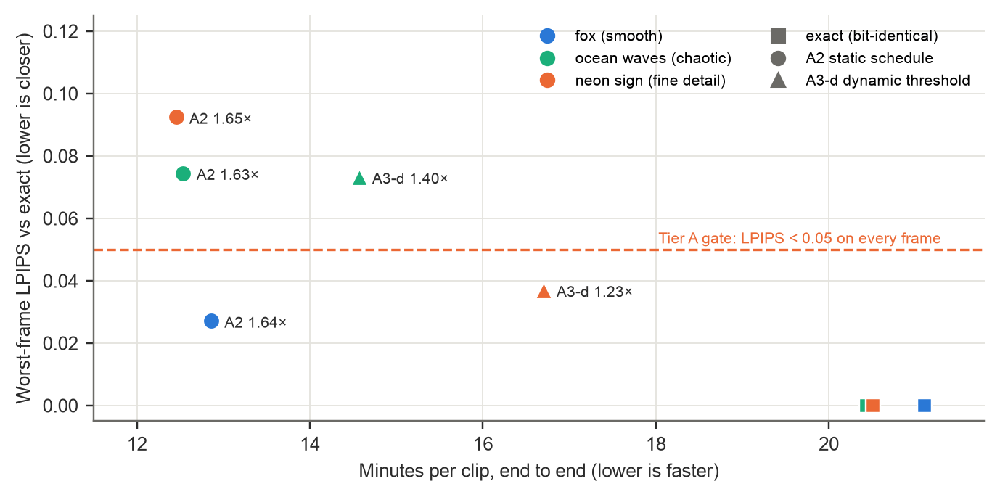
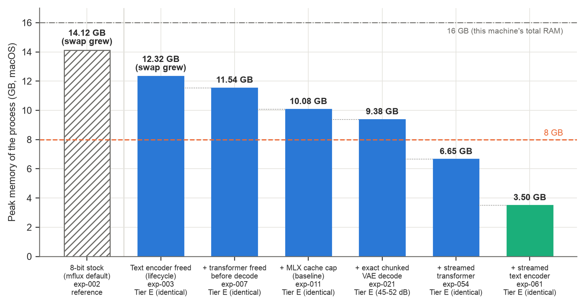
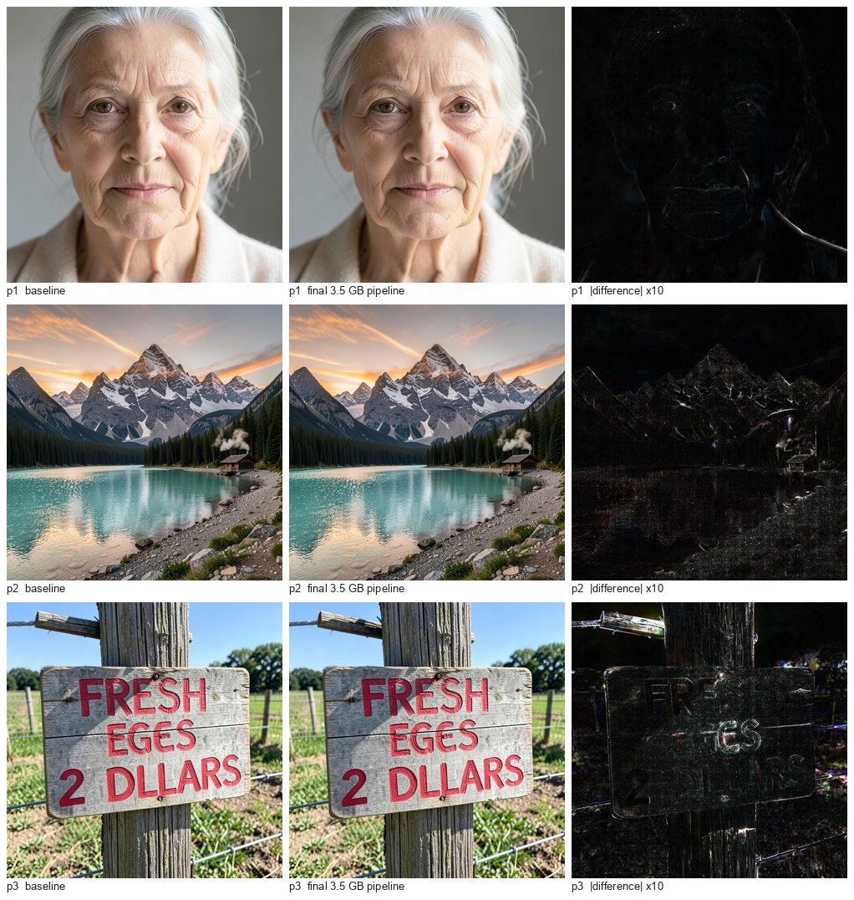

# kernelforge: verified low-memory inference on Apple silicon

Research log and code for running large diffusion models on a 16 GB Apple M5 laptop (MacBook Air, fanless) **without changing
their arithmetic**. Every claim is backed by a recorded run (`runs/<exp>/result.json`), and "exact" means bit-identical to the
stock software unless a tier says otherwise.

| Model | Task | Stock on a 16 GB M5 | This work | Exactness |
|---|---|---|---|---|
| FLUX.2 [klein] 4B | text-to-image, 1024², 4 steps | 10.1 GB peak | **3.5–3.7 GB** peak, +7 % time (cold single image) | bit-identical to the uncompiled stock model on all three test prompts |
| Wan 2.1 T2V 1.3B | text-to-video, 832×480, 36 frames, 50 steps | 2 of 3 stages cannot run without heavy swap (encoder 23.9 GB; decoder 17.9 GB tiled, impossible untiled) | **8.57 GB** peak, swap flat, ~20.5 min per clip | final latents bit-identical to stock; frames identical to stock's exact decode wherever stock can run it |

**Reports**
- [`reports/klein-m5-report.pdf`](reports/klein-m5-report.pdf): Klein 4B, memory 10.1 → 3.5 GB, speed track closed at ~95 % of the chip's measured matmul ceiling.
- [`reports/wan-m5-report.pdf`](reports/wan-m5-report.pdf): Wan 2.1 1.3B, exact video pipeline in 8.6 GB; step caching tested and not shipped.
- Working logs: `reports/phase0.md`, `reports/phase1.md`, `reports/current_state.md`, `reports/speed_track_closure.md`, `reports/phase4b.md`.

## Results at a glance

**Wan 2.1: peak memory per stage, stock vs the exact pipeline**

**Wan 2.1: memory over one full clip**

**Wan 2.1: stock's own tiled decode, the exact pipeline, and the (unshipped) fast mode, frames 1 / 18 / 36**

**Wan 2.1: step caching, speed vs worst-frame quality on three prompts.** No configuration passed the gate on all three, so no
fast mode ships; the curve and the reasons are in the Wan report.

**Klein 4B: memory, step by step**

**Klein 4B: baseline vs the exact pipeline on the three test prompts**

Per-run output images and the Wan videos are under `runs/<exp>/` (e.g. `runs/exp-127-composed/video.mp4`,
`runs/exp-ref-v2/video.mp4`, `runs/exp-ref-v3/video.mp4`).

## What made it fit

- **Block weight streaming with prefetch** (`engine/streaming.py`): two or three transformer blocks resident, the next one loading
  while the current one computes; per-block compile and a lag-1 barrier keep the GPU busy. Klein +2.1–2.8 % per step, Wan +0.1–0.7 %.
- **Upcast-on-load streaming + row-gathered embeddings** (`adapters/wan/te_stream.py`, `engine/rowgather.py`): an fp32 text encoder
  stored as bf16 blocks, upcast as each loads; only the prompt's embedding rows are read from disk. Wan's umT5: 23.1 → 2.07 GB, exact.
- **Exact chunked decoders**: Klein's 2D row-chunked VAE (`engine/chunked.py`), and a new exact 3D streaming decoder for Wan
  (`adapters/wan/vae_stream.py`) that streams latent frames with per-convolution causal state and keeps every strip on the
  convolution's Winograd tile grid so the result stays bit-identical.
- **Allocator cache cap, freeing stages after last use, evaluation barriers**: see `library/patterns/`.

The pattern library (`library/patterns/*.yaml`, `library/notes/*.md`) records each pattern's preconditions, measured results per
model, and failure cases, including rules learned the hard way (memory fixes are serial; exactness is verified at the shipping step
count and on the same random-number path; denoising change is U-shaped).

## Repository layout

| Path | Contents |
|---|---|
| `engine/` | model-agnostic pieces: weight streaming, chunked ops, row-gathered embeddings, similarity probes |
| `adapters/flux2_klein/`, `adapters/wan/` | model-specific adapters (benchmarks, streaming encoders, decoders, the step-cache controller) |
| `bench/` | measurement tools: memory trace, power/thermal, cool-down gate, quality gates (PSNR, LPIPS, flicker) |
| `library/` | the pattern library and lessons |
| `runs/<exp>/` | per-experiment results (`result.json`, `gate.json`, logs, memory traces, output images and videos) |
| `reports/` | reports, PDF builders (`build_report.py`, `build_wan_report.py`) and figures |
| `scripts/` | sync / remote-run / pull helpers and the batch scripts for each phase |
| `results.jsonl`, `RESULTS.md` | the experiment log |
| `PROJECT_BRIEF.md`, `NOTES.md` | the brief and running notes |

**Not included in this repository** (too large; kept locally): raw frame arrays (`frames.npy`), latents and other tensors
(`*.safetensors`), raw powermetrics dumps (`power.txt`; summaries are in each run's `power.json`), and model weights. The reports and
every `result.json` / `gate.json` are complete; rebuilding the PDFs from scratch needs the raw arrays.

## Setup

Code lives on a local Mac; every measurement runs on the M5 test machine over SSH.
- `scripts/sync.sh` pushes code, `scripts/remote.sh <job> '<cmd>'` runs it detached in tmux on the test machine, `scripts/pull.sh`
  fetches `runs/`, `scripts/record.py` logs an experiment to `results.jsonl`, `RESULTS.md` and `dataset/candidates.jsonl`.
- `python3 dashboard/server.py` serves the local experiment tracker at http://localhost:8790.
- Stack: MLX 0.32.4; mflux 0.23.0 (Klein); mlx-video @ 87db56a (Wan); LPIPS (AlexNet) via torch.

## Protocol rules

- **R1 (execution mode):** every correctness comparison uses a reference produced in the *same* execution mode (eager vs
  `mx.compile`). Cross-mode differences are reported separately. Background: `library/notes/eager-vs-compiled-numerics.md`.
- **R2 (simulation):** `mx.set_memory_limit` is a soft limit; no smaller-machine claim is made from it. 8 GB claims need a real 8 GB Mac
  (not yet tested).
- **R3 (timing validity):** a run whose swap grew is memory-only; timing comparisons alternate A/B processes with cool-downs to a
  Nominal thermal state.
- **Tiers:** E = bit-identical or PSNR > 40 dB; A = LPIPS < 0.05 on every frame/image, plus visual review.

## Third-party models and software

FLUX.2 [klein] 4B (black-forest-labs, Apache-2.0), Wan 2.1 T2V 1.3B (Wan-AI, Apache-2.0), mlx-video (MIT), mflux, MLX. Model
weights are not included; download them from their official sources.
